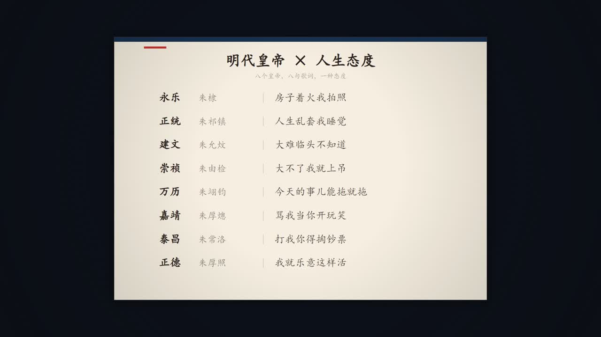

# music-to-video

把一首歌做成一支 MV。输入 `mp3 + lrc`，输出横屏或竖屏 MP4。**画面全部由代码生成**，不用素材站素材，也不依赖生图模型。

| 片头 | 间奏空镜 | 尾奏对照表 |
|---|---|---|
|  |  |  |

> 示例《人生态度》：55 镜 / 1920×1080 / 30fps / 159 秒，全片由 canvas 逐帧绘制。

---

## 这个项目解决什么问题

把"给一首歌配画面"拆成**可验收的八步**，每一步都有产物和判据，而不是打开剪辑软件凭感觉拖时间轴：

```
source/  mp3 + lrc
   │  npm run mv:analyze
   ▼
analysis/  audiomap.json（逐帧能量/BPM/onset/段落）· lyrics.json · structure.md
   │  prompts/01 → 05，中间四个人工拍板点
   ▼
concept/  歌词解读 · MV 概念 · 风格定义 · 分镜（storyboard.json）
   │  project/src（每首歌自己的导演代码）
   ▼
frames/ → ffmpeg → out/*.mp4 → qc.md
```

三条硬规矩：

1. **分镜时间只能来自音频**——`audiomap.json` 或歌词时间，不许凭感觉。
2. **风格与形式由人拍板**——AI 出选项，人做决定，批准记录写进 `song.json`。
3. **一句一镜**——歌词行驱动切分，宁可镜头多，不要一句词跨三个画面。

## 特性

- **八阶段状态机**：`source → analyzed → concept → style → storyboard → refs → building → rendered`，`npm run stage` 随时告诉你缺什么。
- **五个必经的人工审核点**：方向、概念、样式、分镜、参考图，`approvals` 没记录就不许进下一步。
- **程序化渲染**：canvas + Chrome DevTools Protocol 逐帧截图，6 进程并行，1080p 全片约 2.5 分钟。
- **分层镜头语言**：场景 → 环境动效 → 人物调度 → 道具 → 特殊演出 → 歌词条 → 后期，每层可单独替换。
- **歌词条动画**：上浮放大 → 弹跳回弹 → 印章砸下 → 淡出，参数化到每一行。
- **换音频版本可重定时**：同一首歌换了母带（时长不同）时，`--lrc-scale` + `mv:retime` 按比例对齐，不用重做分镜。
- **多 AI 工具共享**：`AGENTS.md` 是单一真源，Claude Code / Cursor / Codex / ZCode 通过 `CLAUDE.md` 与 junction 读同一份规则。

## 快速开始

### 环境

| 依赖 | 说明 |
|---|---|
| Node.js ≥ 22 | 所有脚本都是 ESM，22 起自带全局 `WebSocket`（CDP 渲染需要） |
| Chrome 或 Edge | 逐帧渲染的宿主浏览器 |
| FFmpeg / ffprobe | **full build**，必须含 `loudnorm` 滤镜 |

```bash
npm run doctor        # 一条命令自检上面三项，并列出缺失项
```

### 给一首歌做 MV

```bash
# 1. 建档：复制模板、导入音频与歌词、跑分析（一条命令）
npm run mv:new -- "歌名-艺人" --audio "/path/song.mp3" --lrc "/path/song.lrc"

# 2. 看当前进度与下一步
npm run stage -- 歌名-艺人

# 3. 按 prompts/ 里的五段提示词产出 concept/ 下的四份文档（人审后再往下）
#    分镜写完必须校验
npm run mv:validate -- 歌名-艺人

# 4. 渲染前先抽几帧看画面（比渲全片便宜 1000 倍）
npm run mv:snap -- 歌名-艺人 --times 12,45,80,120,150

# 5. 全片渲染 + 质检
npm run mv:render -- 歌名-艺人 --workers 6 --crf 19
npm run mv:check  -- 歌名-艺人
```

### 换音频版本（可选）

同一首歌换了母带、时长变了，但不想重做分镜：

```bash
SCALE=$(node -e "console.log(160.0/156.0)")   # 新时长 / 旧时长
npm run mv:analyze -- 歌名-艺人 --lrc-scale $SCALE
npm run mv:retime  -- 歌名-艺人 --scale $SCALE
npm run mv:validate -- 歌名-艺人
```

## 目录结构

```
.
├─ AGENTS.md            # 项目单一真源：铁律、目录契约、数据格式
├─ CLAUDE.md            # 薄壳，导入 AGENTS.md
├─ prompts/             # 五段提示词：解读 / 概念 / 风格 / 分镜 / 图像提示词
├─ docs/                # 流程、工具链、多工具协作、选型记录
├─ tools/               # 建档、分析、校验、质检、重定时、分镜表生成
├─ engines/canvas/      # 渲染引擎：静态服务 + CDP 逐帧 + ffmpeg 合成
└─ songs/
   ├─ _template/        # 新歌骨架，mv:new 复制它
   └─ 人生态度-王七七/   # 完整示例（不含音频与歌词，见下）
      ├─ song.json      # 元信息 / 画幅 / 风格 / 阶段 / 审核记录
      ├─ analysis/      # 机器产物（audiomap、structure）
      ├─ concept/       # 歌词解读、MV 概念、风格定义、分镜
      └─ project/src/   # 这首歌自己的渲染代码
```

## 渲染架构

示例歌曲的 `project/src/` 四个文件，各自只干一件事：

| 文件 | 职责 |
|---|---|
| `emperor.js` | 素材库：角色 / 服饰 / 道具 / 场景 / 印章 / 歌词条的 SVG 生成器，全部参数化 |
| `director.js` | 55 镜调度表 + 绘制：场景、色调、人物入场与持续动作、环境动效、道具、特殊演出 |
| `fx.js` | 环境动效：火星、青烟、浮尘、花瓣、水波、风、星、纸屑、裂缝、声波、药丸、金光 |
| `main.js` | 时间轴、预加载、镜头运动、歌词条关键帧、后期（颗粒 / 暗角 / 淡入淡出） |

一镜的实现是**数据驱动**的，不用给 55 个镜头各写一个函数：

```js
s13: {
  scene: 'hall', grade: 'warm', cam: { push: 0.06 },
  cast: [C('taichang', 'surprised', 'hold', { prop: 'pills', x: 0.35, y: 0.3, w: 0.31, enter: 'pop', act: 'idle' })],
  fx: ['pills'], glow: { x: 0.5, y: 0.58, r: 0.2, color: '#ff5a4a', a: 0.22 },
}
```

- **入场**：`pop` / `rise` / `drop` / `slideL` / `slideR`，都用 overshoot 回弹而不是线性 ease
- **持续动作**：`bounce` / `shake` / `sink` / `sway` / `nod` / `idle`
- **镜头**：`push`（缓推）/ `panX`（横移）/ `shake`（手持微抖）
- **歌词条**：0–0.4s 上浮放大到 1.05 → 0.55s 缩到 0.97 并转 -1.2° → 0.7s 1.02 / +1° → 0.85s 归位 → 落章后保持 → 行尾淡出；印章从 2.6 倍 / -24° 砸到 1 倍 / -8°

## 命令

| 命令 | 作用 |
|---|---|
| `npm run doctor` | 环境自检 |
| `npm run stage -- <歌>` | 看进度 / `--next` 推进 |
| `npm run mv:new -- "歌名-艺人"` | 复制模板建档 |
| `npm run mv:analyze -- <歌>` | 音频分析 + 解析 LRC（`--lrc-scale` 可整体缩放时间） |
| `npm run mv:validate -- <歌>` | 校验分镜时间轴、字段、歌词覆盖 |
| `npm run mv:snap -- <歌> --times 12,45` | 抽帧预览 |
| `npm run mv:render -- <歌> --workers 6` | 全片渲染（`--crf`、`--from/--to` 局部渲染） |
| `npm run mv:check -- <歌>` | 质检：分辨率 / 帧率 / 音轨 / 时长 / 帧完整性 |
| `npm run mv:retime -- <歌> --scale 1.02` | 时间轴重定时 |
| `npm run sb:md -- <歌>` | 由 storyboard.json 生成人读分镜表 |

## 示例说明（重要）

`songs/人生态度-王七七/` 是完整的设计与代码示例，但**不包含**：

- 音频（mp3 / flac）与 LRC
- 歌词全文（`analysis/lyrics.json`）
- 成片 mp4

这些内容版权归原作者，只在本地使用。为了让示例仍可阅读，分镜与结构文档里的歌词文本统一替换为行号 `L01`–`L52`，时间、画面、镜头、动效全部保留。

要复现：把自己的音频与 LRC 放进 `source/`，把 `song.json` 的 `source.audio` / `source.lrc` 指过去，重跑 `mv:analyze` 即可。示例里的 `director.js` 依赖歌词行号与 `meme-map.json` 的映射，换歌需要重写每一镜的调度。

## 已知限制

- **字体**：依赖系统中文字体（楷体 / KaiTi）。Linux 上需要自己装一份，否则字幕会 fallback 成黑体。
- **引擎**：目前只有 canvas 引擎。`engines/` 目录预留了扩展位，但 Remotion 路线没有接入。
- **示例不可直接渲染**：缺音频与歌词，属有意为之。

## License

代码以 [MIT](LICENSE) 发布。示例中涉及的歌曲、歌词、演唱者相关权利归原作者所有，不在本仓库授权范围内。
